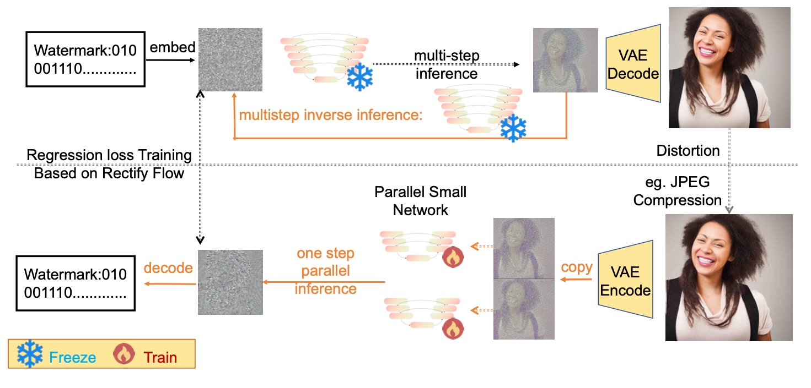
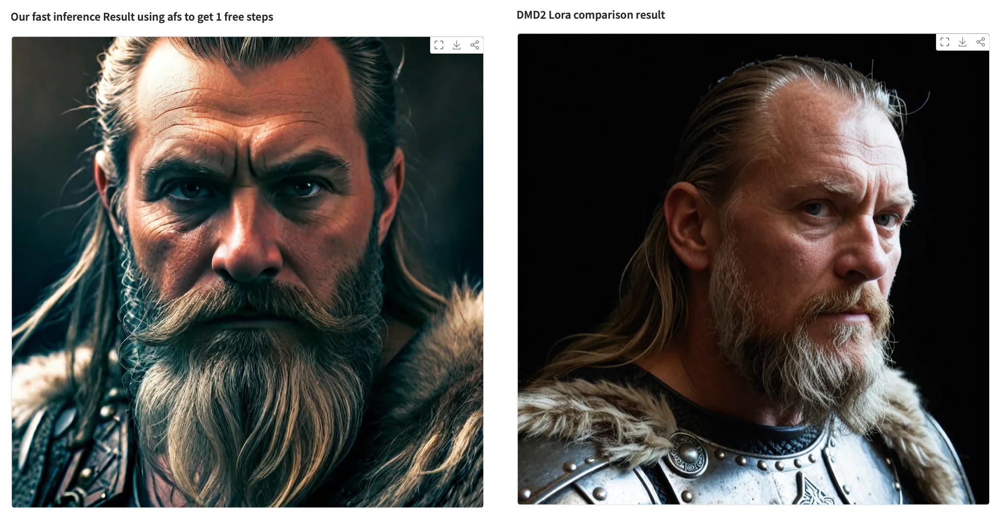
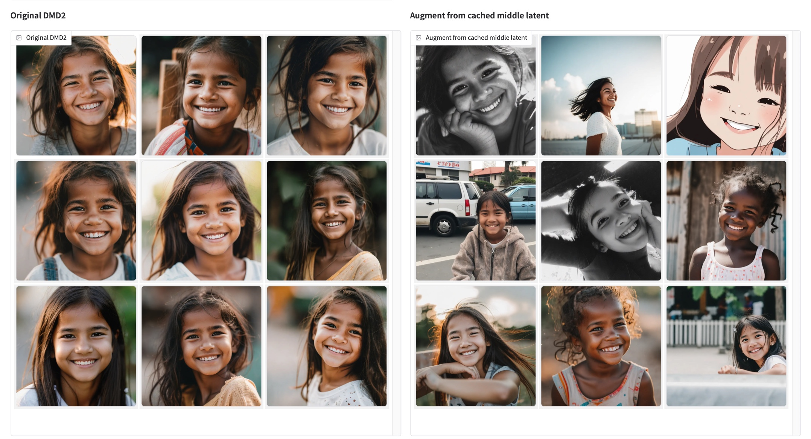

# Zilai Li

**Independent Researcher & Software Engineer**  
_Diffusion & Flow-Matching Generative Models · Fast Numerical ODE/SDE Samplers · Generative AI Safety & Watermarking_

---

## 👋 About Me

I am an Independent Researcher working on **efficient generative modeling** and **trustworthy generative AI**, and a Software Engineer. My research focuses on discrete diffusion ODE analysis, training-free fast ODE schedules (`F-scheduler`), PAC/Information-Bottleneck analysis and diversity restoration for few-step diffusion distillation (`EMPURPLE`), and ultra-fast one-step semantic watermark extraction (`RAIN`).

### 🎓 Education

- **University of Nottingham** _(Nottingham, United Kingdom · 2021 – 2022)_  
  **M.Sc. in Computer Science (With Merit)**
- **China University of Geosciences, Beijing (CUGB)** _(Beijing, China · 2016 – 2020)_  
  **B.Eng. in Computer Science and Technology**

---

## 📄 Research & Publications

### 1. RAIN: Region-Aware Inversion Network for Semantic Watermark Extraction

> **Zilai Li**  
> 🏆 **Accepted at BMVC 2026 TrustVis Workshop (Oral Presentation)**  
> [[arXiv:2609.14856](https://arxiv.org/abs/2609.14856)] · [[Paper PDF](assets/pdf/RAIN_BMVC2026_TrustVis.pdf)] · [[GitHub Repository](https://github.com/TheLovesOfLadyPurple/RAIN-lightweight-NN-for-one-step-semantic-watermark-extraction)]

  

- Decomposes high-SNR endpoint statistic recovery for Gaussian-Shading semantic watermarks into a prompt-free, U-Net-free, dual-branch width-64 **NAFNet** architecture (`F_0` anchor branch and `F_1, F_2` residual/timestep branch executing concurrently across separate CUDA streams).
- Achieves **47.4× fewer FLOPs** (`14.394 GFLOPs` vs. `~680 GFLOPs`), **56× fewer parameters** (`15.468M`), and **1.39 ms/image** latency (**22.5×–26.8× speedup** over OSI and FARI), matching 50-step DDIM Inversion accuracy (`99.99%`) with strong robustness across 10 distortions.

---

### 2. F-scheduler: Illuminating the Free-Lunch Design Space for Fast Sampling of Diffusion Models

> **Zilai Li**, Lujia Bai  
> 📝 **Under Review at Transactions on Machine Learning Research (TMLR)**  
> [[arXiv:2510.02390](https://arxiv.org/abs/2510.02390)] · [[GitHub Repository](https://github.com/TheLovesOfLadyPurple/F-scheduler)] · [[🤗 Interactive Demo: DMD2 vs F-Scheduler](https://huggingface.co/spaces/coralLight/DMD2vsF-Scheduler)]

  

- Proposes a training-free time schedule (retaining controlled terminal noise so the $\beta$-VAE decoder can leverage its KL-regularized latent distribution) paired with stage-scheduled **Free-U Net** skip-connection modulation for few-step (`5–8` steps) diffusion ODE solvers (`UniPC`, `DPM++ 2M`).
- Coupled with **Analytical First Step (AFS)**, **5–8 step `F-scheduler`** (`5` steps on `512×512` SD 1.5, `6` steps on `1024×1024` SDXL) outperforms **4-step `DMD2` LoRA** distillation and 20-step `DPM++ 2M` in FID and visual detail without distillation training.

---

### 3. EMPURPLE: A Free Lunch for Diffusion Distillation based on the Information Bottleneck

> **Zilai Li**, Lujia Bai  
> 📝 **Preprint** _(Not yet submitted to a conference or workshop)_  
> [[arXiv:2607.04276](https://arxiv.org/abs/2607.04276)] · [[GitHub Repository](https://github.com/TheLovesOfLadyPurple/Empurple-Training-Free-Algorithm-To-enhance-Diversity-of-The-Diffusion-Distillation-Model)] · [[🤗 Interactive Demo: EMPURPLE](https://huggingface.co/spaces/coralLight/EMPURPLE)] · [[Colab Notebook](https://colab.research.google.com/drive/1DVw41J_7yzhBxRhhNeOsCFxz-ROZWHLw?usp=sharing)]

  

- Uses **PCA on the covariance matrix of early-step outputs** to quantify output complexity (entropy), showing that the teacher diffusion model's early-step outputs have lower complexity (and thus a **smaller hypothesis space** under a PAC-style generalization bound and the Information Bottleneck principle) than the distilled model's aggressive early-step outputs, which suffer from an enlarged train–test gap and intermediate latent distribution shift.
- Introduces **EMPURPLE**, a training-free intermediate-latent recycling method (e.g., reusing noisy latents cached at $t=852$ from an 8-step SDXL UniPC pass) that restores generation diversity and improves FID by **7%–20%** across `DMD2` (**+20% FID**), `Hyper-SD`, `FlashSD`, and `SDXL-Lightning`.

---

## 🛠️ Open-Source Contributions & Interactive Spaces

### Merged Pull Request in `huggingface/diffusers`

- **[PR #14011](https://github.com/huggingface/diffusers/pull/14011)** _(Merged Jul 2026)_ — **Fix Rectified Flow Time Scheduler Problem (`FlowMatchEulerDiscreteScheduler`)**  
  Fixed custom timestep shifting in `FlowMatchEulerDiscreteScheduler.set_timesteps` when `shift != 1`, ensuring consistency between custom `timesteps` and `num_inference_steps` schedules for Rectified Flow / Flow Matching solvers.

### 🤗 Hugging Face Interactive Spaces (`@coralLight`)

| Space                         | Description                                                                                    | Link                                                                           |
| :---------------------------- | :--------------------------------------------------------------------------------------------- | :----------------------------------------------------------------------------- |
| **DMD2 vs F-Scheduler**       | Side-by-side SDXL comparison between 5–8 step `F-scheduler + AFS` and 4-step `DMD2` LoRA       | [🤗 Space](https://huggingface.co/spaces/coralLight/DMD2vsF-Scheduler)         |
| **EMPURPLE**                  | Training-free diversity enhancement for `DMD2` using recycled intermediate latents ($t = 852$) | [🤗 Space](https://huggingface.co/spaces/coralLight/EMPURPLE)                  |
| **F-scheduler 4K**            | High-resolution 4K ultra-fast synthesis powered by `F-scheduler`                               | [🤗 Space](https://huggingface.co/spaces/coralLight/F-scheduler-4k)            |
| **F-scheduler DreamshaperXL** | Few-step `DreamshaperXL` text-to-image generation with `F-scheduler`                           | [🤗 Space](https://huggingface.co/spaces/coralLight/F-scheduler-DreamshaperXL) |
| **F-scheduler Animation**     | Fast anime/stylized SDXL generation using `F-scheduler`                                        | [🤗 Space](https://huggingface.co/spaces/coralLight/F-scheduler-Animation)     |
